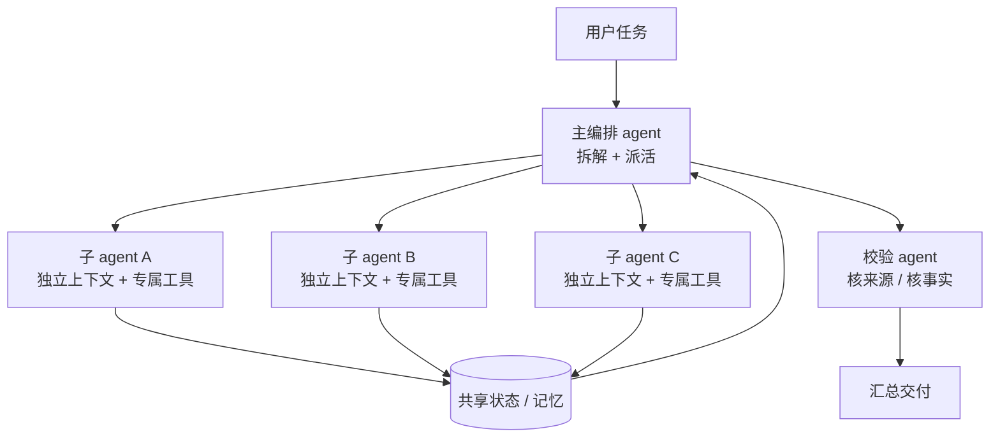

# 多 agent 团队：把一个大任务拆给几个"各有专长"的 AI

## 一、学习目标

看完这份笔记，你应该能回答三个问题：

1. 多 agent 团队和"一个 agent 装很多工具"到底差在哪，什么情况下值得上？
2. 生产环境里真正跑得通的拓扑有哪几种，各自的代价是什么？
3. 为什么很多多 agent 项目跑不起来，失败点具体在哪一层？

## 二、一句话理解

多 agent 团队就是给 AI 分工：几个各自带工具、各自有独立上下文的 agent 通过消息协作，把超出单个上下文窗口、或者天然能并行的活儿拆开来做。

打个比方，它更像一个编辑部而非一个全能记者：主编定选题、派活、统稿；几个记者各跑一条线；校对最后核来源。记者之间不共享脑袋，只交稿子——这个"只交稿子"既是它的效率来源，也是它的信息损耗来源。

## 三、核心机制：它是怎么转起来的

一个多 agent 系统由四个零件组成，缺一个就跑不顺：

| 零件 | 作用 | 出问题时的典型表现 |
|---|---|---|
| 编排层（orchestrator） | 拆任务、派活、收结果、判断要不要再来一轮 | 简单问题也派 5 个 agent，烧钱 |
| 子 agent（worker） | 各自独立的上下文窗口 + 专属工具和提示词 | 任务描述含糊，几个人重复搜同一件事 |
| 通信协议 | agent 之间传什么、用什么格式传 | 自由文本互传，字段漂移，下游理解错 |
| 共享记忆 / 状态 | 谁持有"当前进展"这个唯一事实源 | 两处状态不一致，agent 各说各话 |

为什么拆开反而更强？Anthropic 在讲他们 Research 功能的那篇工程博客里给了一个很实在的解释：检索的本质是压缩，子 agent 用自己的上下文窗口并行啃不同侧面，把海量信息压成少量关键 token 交给主编；同时每个子 agent 有自己的工具和探索路径，减少了"一条道走到黑"的路径依赖。

他们公布的数据值得记住：主编用 Opus 4、子 agent 用 Sonnet 4 的配置，在他们内部的 research 评测上比单用 Opus 4 高出 90.2%。而在 BrowseComp 评测里，光"token 用量"一项就解释了 80% 的性能差异——换句话说，多 agent 之所以强，很大一部分原因是它把更多算力花在了同一个问题上。

这句话反过来读就是它最大的软肋，下面第六节会展开。

## 四、三种能上生产的拓扑

2026 年市面上真正在跑的架构基本收敛到三种。

**1. 编排-执行（orchestrator-worker）**

一个编排 agent 分类任务、拆子任务、派给专业 worker、合并结果。一层路由、多层并行，可观测性可控。多个行业观察口径都把它列为生产环境的默认选项（有统计称约占 70% 的生产部署，此数据出自二手分析，待核实）。

适合：调研报告、内容生产、多来源数据分析——那些任务边界清楚、能干净拆开的活儿。

**2. 层级式（supervisor / hierarchical）**

顶层主管派给中层协调者，中层再派给 worker。好处是能做预算管控——主管可以给每条分支设 token 上限，跑偏的子树直接砍掉，审计链干净。代价是延迟：三层结构、每层一次 2 秒的模型调用，任何 worker 开跑之前就先花了 6 秒以上。交互式场景基本不能用。

**3. 对等 / 蜂群（peer-to-peer / swarm）**

没有中心，agent 读写共享黑板。并行度最高，也最难查错——出了问题没有一条完整调用链可以回放，只能拿多个并发 agent 的行为去复原。强监管领域（金融、医疗、欧盟 AI Act 附件三覆盖的场景）通常不认这种架构。

另外还有一种在生产里很常见的变体：**顺序流水线**（提取 → 校验 → 转换 → 分发）。它严格说不算"团队"，但对文档处理这类线性任务，可审计性最好，每一段都有独立日志。

## 五、真实场景长什么样

**场景一：Anthropic 的 Research 功能**

用户提问 → LeadResearcher 分析并规划 → 并行生成若干子 agent 各查一个方向 → 子 agent 用交错思考边搜边评估 → LeadResearcher 综合，判断是否还要补查 → CitationAgent 逐条核引用位置 → 输出带引用的报告。

有个工程细节很值得抄：上下文超过 200K token 必然被截断，所以 LeadResearcher 会把计划先写进 Memory，截断后还能捡回来。

**场景二：法律运营团队的合同审查（二手案例，出自行业博客）**

原来是单 agent 处理合同提取，试点阶段表现好，一上量就崩：复杂多附表文档开始上下文出错，高峰期排队。改成四个 agent 后——分类 agent 判文档类型和复杂度、结构化提取 agent 按固定 schema 抽条款、风险标注 agent 独立复核（刻意不读提取结果，避免确认偏误）、组装 agent 出审查备忘录。半年后复杂文档提取准确率从 81% 提到 96%，单份审查从 2.3 小时降到 22 分钟。

这个案例的关键点在于：风险标注 agent 被设计成"不依赖前一个 agent 的输出"。多 agent 的价值有时候就在这里——用独立视角对冲单条链路上的错误。

## 六、容易混淆的四个概念

| 对比对象 | 区别在哪 | 什么时候用哪个 |
|---|---|---|
| 单 agent + 多工具 | 一个上下文、一条推理链，只是工具多 | 绝大多数任务。工具装到 10 个以内都还好 |
| 工作流编排（workflow） | 路径是人写死的（Dify、n8n、Coze 那种） | 步骤确定、要稳定可复现。多 agent 是让模型自己决定路径 |
| 微服务架构 | 多 agent 拆的是"认知"，微服务拆的是"功能部署" | 两者不在一个层面，别混着比 |
| Skill / 提示词包 | Skill 是给同一个 agent 换一套做事方法 | 需要复用方法论时用 Skill，需要并行啃硬骨头时用 agent 团队 |

## 七、使用边界：什么时候不该上

**先说结论：多 agent 是给"上下文碎片化"的问题准备的，推理深度型的问题用它没好处。**

2026 年 4 月斯坦福那篇论文（Tran & Kiela, arXiv 2604.02460）把这个讲清楚了。他们用数据处理不等式（Data Processing Inequality）做了一个论证：固定思考 token 预算、且单 agent 的上下文利用没退化时，单 agent 的信息效率更高，因为每一次 agent 之间的转交都是一个只能丢信息、不能加信息的处理步骤。他们在 Qwen3、DeepSeek-R1-Distill-Llama、Gemini 2.5 三个模型家族上做了对照实验（预算 100 到 10000 token，FRAMES 和 MuSiQue 4-hop 两个数据集），结论是：等预算下，单 agent 在多跳推理上稳定打平或超过多 agent。

他们还顺手发现了一个评测漏洞：Gemini 2.5 的 API 对思考 token 上限执行不严，导致多 agent 在同预算下实际花了更多算力——一批基准成绩是拿有问题的尺子量出来的。

而伯克利那篇 MAST（arXiv 2503.13657，NeurIPS 2025）从反面补了一刀：他们分析了 7 个主流多 agent 框架、200 多个任务、1600 多条轨迹，归纳出 14 种失败模式，分三大类——规范与系统设计、agent 间错位、任务验证与终止。AppWorld 上某些配置的故障率能到 86.7%。他们做干预实验能把完成率提 14%，但没法根治，说明很多问题是结构性的。

**成本账**：Anthropic 的数据是普通 chat 用 1 份 token，单 agent 大约 4 份，多 agent 大约 15 份。另有二手分析给出独立 peer 架构约 +58%、集中 supervisor 架构约 +285% 的开销（待核实）。企业落地普遍把团队规模压在 3—4 个 agent，因为协调开销随人数涨得很快。

**实操判别法**（很便宜，值得每次都先跑）：
把准备派给 4 个 agent 的任务，交给 1 个 agent，给它同样的总 token 预算，并明确要求"先做前置分析再作答"。如果结果打平，就别上多 agent。

**几个高频坑**：

- 派活描述太含糊。Anthropic 举的例子是"研究半导体短缺"，结果三个子 agent 两个重复查同一年供应链，一个跑去查 2021 年汽车芯片危机。每个子任务必须给目标、输出格式、工具指引、任务边界。
- 不设终止条件。没有明确的成功契约，编排 agent 会反复重派，token 一直烧。
- 幻觉级联。上游 agent 编的东西成了下游的"事实"。解法是加校验 agent、强制引来源、用结构化输出。
- 一开始就搭大团队。正确做法是一个一个加，每加一个都要有基准证明它真的让结果变好。

## 八、落到 WorkBuddy：这里的"团队"由四层组成

这一节是给自己的操作手册，也解释了为什么这个工作区叫"多agent团队"。

| 层 | 是什么 | 什么时候用 |
|---|---|---|
| Skill（技能） | 一套方法论 + 流程 + 模板，默认注入主对话 | 需要"按某种规范做事"，比如调研、图卡生产、批改 |
| Subagent（子代理） | 独立执行体，有独立上下文、工具白名单、模型、轮数上限 | 重活要隔离，避免污染主对话上下文；或者要并行 |
| Team（团队） | 多个具名 agent 通过消息和共享任务列表协作 | 任务能切成几条互不依赖的线 |
| Automation（自动化） | 只管"什么时候触发" | 定时任务，和前三层正交 |

缝合点在于 Skill 的 `context: fork`：它会切断对话历史，所以依赖当前对话输入的活儿不该用 fork，正确做法是把重活抽成一个独立 agent。

本机已有的子代理（2026-10 状态）：`hotspot-renderer`（图卡渲染与验收）、`quiz-grader`（测验批改），另有内置的 `Explore`（只读探查）、`Plan`（方案设计，只读）。自定义 agent 定义放 `C:\Users\lancy\.workbuddy\agents\<name>.md`。

**判断要不要开团队，按这个顺序问**：

1. 一个 agent 加几个工具能不能干完？能，就别开。
2. 干不完是因为上下文装不下，还是因为推理太绕？上下文装不下 → 值得拆；纯粹推理绕 → 换个更强的模型比拆 agent 划算。
3. 拆出来的子任务之间能不能不共享上下文？能 → 可以并行；必须频繁共享 → 拆了会更差。

## 九、自测

1. 多 agent 相比单 agent 的性能提升，主要来自什么？

很大程度上来自花掉了更多 token。Anthropic 的 BrowseComp 分析里，token 用量单独就解释了 80% 的性能方差。所以对比时必须控制预算，否则等于拿不同算力在比。

2. 什么类型的任务适合多 agent？

上下文碎片化型：信息量超过单个窗口、子任务天然独立可并行、要对接大量复杂工具。典型是广度优先的调研。推理深度型（多跳推理、链式推导）不适合，等预算下单 agent 往往更好。

3. MAST 把失败分成哪三大类？

规范与系统设计问题、agent 间错位、任务验证与终止。共 14 种具体模式。

4. 三层层级式架构的延迟代价怎么算？

每多一层就多一次串行模型调用。三层结构、每层 2 秒，worker 开跑前就已经等了 6 秒以上。对交互式场景这是硬伤。

5. WorkBuddy 里 Skill 和 Subagent 的分工是什么？

Skill 是内容与流程（怎么做事），默认注入主对话；Subagent 是独立执行体（谁来做），有独立上下文和工具权限。Automation 只负责何时触发，和前两者不在一个维度。

## 十、参考来源

一手与二手的区分见同目录 `sources.md`。以下几篇是核心依据：

- Anthropic Engineering，《How we built our multi-agent research system》——90.2% 提升、15x token、80% 方差、orchestrator-worker 架构、八条提示原则。
- Cemri et al.，《Why Do Multi-Agent LLM Systems Fail?》(arXiv 2503.13657, NeurIPS 2025)——MAST 分类法，14 种失败模式。
- Tran & Kiela，《Single-Agent LLMs Outperform Multi-Agent Systems on Multi-Hop Reasoning Under Equal Thinking Token Budgets》(arXiv 2604.02460, 2026-04)——等预算对照实验与信息论论证。

**待核实项**：拓扑占比"约 70% 生产部署"、"独立 peer +58% / supervisor +285% token 开销"、"企业普遍限制 3—4 个 agent"三条均出自二手行业分析，未在官方口径或论文中交叉验证。法律运营团队案例同样来自二手行业博客，未见原始披露。

---

*本文由 topic-research 技能生成，结论请自行复核后再引用。*
